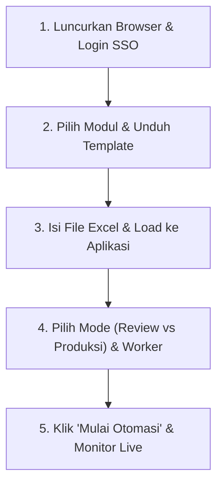
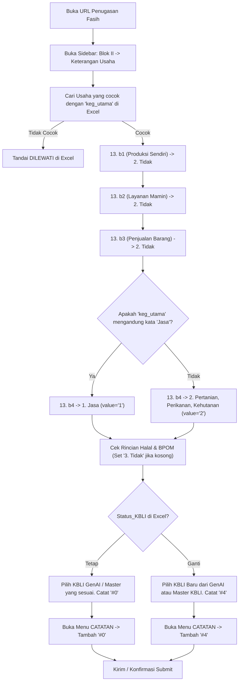

# 🚀 FASIH 3603 Helper
*Suite Otomasi Survei, Pembersihan Data (Data Cleaning), & Verifikasi KBLI*  
**BPS Kabupaten Tangerang (Kode Wilayah: 3603)**

---

## 📌 Daftar Isi
1. [Tentang Aplikasi & Arsitektur](#-tentang-aplikasi--arsitektur)
2. [Panduan Alur Pengguna Baru (Quick Start)](#-panduan-alur-pengguna-baru-quick-start)
3. [Penjelasan Lengkap Algoritma per Modul](#-penjelasan-lengkap-algoritma-per-modul)
   - [1. 🌾 KBLI Kategori A SE2026](#1--kbli-kategori-a-se2026-kbli_kategori_a)
   - [2. 📦 KBLI PMM SE2026 (Penyedia Makanan & Minuman)](#2--kbli-pmm-se2026-kbli_pmm)
   - [3. 🛒 KBLI Sembako SE2026](#3--kbli-sembako-se2026-kbli_sembako)
   - [4. 🏷️ Remark KBLI SE2026 (Umum)](#4-️-remark-kbli-se2026-remark_kbli)
   - [5. 🧹 Cleaning Usaha SE2026](#5--cleaning-usaha-se2026-cleaning_usaha)
   - [6. 🆔 Cleaning NIK R30 SE2026 (Keluarga ART)](#6--cleaning-nik-r30-se2026-cleaning_nik_r30)
   - [7. 🆔 Cleaning NIK R29 SE2026 (Penanggung Jawab Usaha)](#7--cleaning-nik-r29-se2026-cleaning_nik_r29)
   - [8. 🆔 Cleaning NIK R27 SE2026 (Pemilik Usaha)](#8--cleaning-nik-r27-se2026-cleaning_nik_r27)
   - [9. ✅ Approve SE2026 (PML / Taskforce)](#9--approve-se2026-approve_se2026)
4. [Fitur Keamanan, Anti-Detection, & Sesi SSO](#-fitur-keamanan-anti-detection--sesi-sso)
5. [Panduan Instalasi & Build Installer](#-panduan-instalasi--build-installer)

---

## 🏛️ Tentang Aplikasi & Arsitektur

**FASIH 3603 Helper** dirancang khusus untuk mempercepat dan menstandarkan kegiatan penjaminan kualitas data survei dan sensus (seperti Sensus Ekonomi SE2026) pada portal **Fasih BPS** ([https://fasih-sm.bps.go.id](https://fasih-sm.bps.go.id)).

Aplikasi ini hadir dalam **2 varian eksekusi**:

| Fitur / Komponen | 🖥️ Desktop App (Python + Playwright) | 🌐 Browser Extension (Chrome/Edge MV3) |
| :--- | :--- | :--- |
| **Bentuk Aplikasi** | Aplikasi Windows mandiri (`.exe` installer) | Ekstensi Browser native di toolbar Chrome/Edge |
| **Pusat Kontrol** | Antarmuka grafis modern (CustomTkinter) | Side Panel terintegrasi di sisi kanan web Fasih |
| **Pemrosesan Paralel** | Multi-Worker (1 s.d. 5 worker konkuren) | Multi-Tab Worker (1 s.d. 3 tab peramban) |
| **Instalasi Python** | **Tidak perlu** (cukup instal file `.exe` installer) | **Tidak perlu** (cukup pasang folder ekstensi) |
| **Tujuan Utama** | Pengolahan data massal ribuan record otomatis | Operasional harian fleksibel berdampingan dengan web |

---

## 🚦 Panduan Alur Pengguna Baru (Quick Start)

Bagi rekan-rekan yang baru pertama kali menggunakan **FASIH 3603 Helper**, ikuti 5 langkah mudah berikut:



### Langkah 1: Siapkan Browser & Login Fasih
1. Buka aplikasi **FASIH 3603 Helper**.
2. Klik tombol **🌐 Buka Browser** pada panel atas aplikasi (atau buka Chrome/Edge secara normal).
3. Buka situs [https://fasih-sm.bps.go.id](https://fasih-sm.bps.go.id) dan pastikan akun SSO BPS Anda sudah dalam kondisi **berhasil login**.

### Langkah 2: Pilih Modul & Dapatkan Template Excel
1. Di bilah menu sebelah kiri, pilih jenis modul yang ingin dikerjakan (contoh: *KBLI Kategori A*, *KBLI Sembako*, dsb).
2. Klik tombol **📥 Unduh Template**.
3. Simpan file template resmi Excel ke komputer Anda (misal: `template_kbli_kategori_A.xlsx`). Template ini sudah dilengkapi header baku, validasi dropdown, dan contoh isian.

### Langkah 3: Masukkan Data & Muat (Load) ke Aplikasi
1. Buka file template di Microsoft Excel, lalu salin/tempel daftar tugas penugasan Fasih Anda.
2. **PENTING**: Tutup (*close*) file Excel tersebut sebelum dijalankan di bot agar bot dapat menulis status hasil eksekusi tanpa terhalang proteksi file lock Windows.
3. Di aplikasi, klik **📂 Pilih File**, pilih file Excel yang sudah Anda isi.
4. Aplikasi akan otomatis memvalidasi struktur kolom dan menampilkan seluruh data ke tabel pratinjau (*Live Table*).

### Langkah 4: Tentukan Mode Eksekusi
* **Mode Produksi (Otomatis)**: Bot langsung mengonfirmasi dan mengirim (*submit*) penugasan secara otomatis. Cocok untuk data bersih siap kirim.
* **Mode Debug / Review Submit**: Bot mengisi formulir dan memunculkan jendela dialog konfirmasi, lalu **menunggu Anda meninjau**. Anda cukup menekan tombol **ENTER** pada keyboard untuk konfirmasi lanjut ke baris berikutnya.
* **Jumlah Worker**: Pilih 1 s.d. 5 worker sesuai kecepatan koneksi internet (rekomendasi: 2–3 worker).

### Langkah 5: Mulai Otomasi
1. Klik tombol **▶️ Mulai Otomasi**.
2. Anda dapat melihat progres real-time pada kartu metrik, baris tabel yang aktif, dan tab **Log Terminal**.
3. Anda dapat mengklik tombol **⏸️ Jeda** atau **⏹️ Berhenti Aman** kapan saja. Status pengerjaan tiap baris langsung disimpan otomatis ke file Excel Anda.

---

## 🧠 Penjelasan Lengkap Algoritma per Modul

Berikut penjelasan teknis alur logika (*decision tree* & alur kerja) yang dijalankan oleh mesin otomasi pada masing-masing modul:

---

### 1. 🌾 KBLI Kategori A SE2026 (`kbli_kategori_A`)
* **Tujuan**: Penyesuaian KBLI untuk unit usaha Kategori A (Pertanian, Kehutanan, Perikanan, serta Jasa Pertanian) beserta pengisian karakteristik usaha 13.b1 s.d. 13.b4.
* **Struktur Kolom Excel**: `keg_utama`, `kbli_akhir`, `url`, `Status_KBLI`, `KBLI_Terbaru`, `Status_Eksekusi`, `Keterangan`.
* **Alur Logika & Algoritma**:



> [!NOTE]
> **Deteksi Kata Jasa**: Bot menggunakan pencarian kata spesifik (case-insensitive) pada nama kegiatan utama. Contoh yang otomatis memilih **1. Jasa**: *JASA PENGGILINGAN PADI*, *Jasa air taman*, *JASA PEMOTONGAN POHON*, *Jasa angkut hasil pertanian*, *Jasa tanam benih*, *Jasa penyewaan traktor*, dll.

---

### 2. 📦 KBLI PMM SE2026 (`kbli_pmm`)
* **Tujuan**: Penanganan KBLI Penyedia Makanan dan Minuman (Restoran, Rumah Makan, Kafe, Warung Makan, Katering, Pedagang Makanan Keliling/Kaki Lima).
* **Alur Logika & Algoritma**:
  1. Navigasi ke penugasan dan buka usaha Blok II yang cocok.
  2. **Karakteristik Usaha PMM**:
     - **13. b1** (Memproduksi barang di lokasi ini?): Memilih **2. Tidak**.
     - **13. b2** (Menyediakan layanan makan dan minum?): Memilih **1. Ya**.
     - **13. c1** (Makanan/minuman diproduksi/diolah sendiri?): Memilih **1. Ya**.
     - **13. c2** (Aktivitas utama penyediaan mamin): Memilih opsi penyajian menetap (*56101 - Restoran/Rumah Makan*) atau keliling/kaki lima (*56102*) sesuai petunjuk penugasan.
  3. Mengisi rincian Sertifikat Halal & Izin Edar BPOM jika belum terisi.
  4. **Penetapan KBLI**:
     - Jika `Status_KBLI == "Tetap"`: Memilih kode KBLI eksisting dan menyematkan catatan `#0`.
     - Jika `Status_KBLI == "Ganti"`: Memilih `KBLI_Terbaru` (misal 56101/56102) dan menyematkan catatan `#4`.
  5. Menyematkan catatan di sidebar dan melakukan submit formulir.

---

### 3. 🛒 KBLI Sembako SE2026 (`kbli_sembako`)
* **Tujuan**: Penyesuaian KBLI Perdagangan Eceran Sembako / Toko Kelontong / Minimarket (membedakan KBLI 47111 vs 47211).
* **Alur Logika & Algoritma**:
  1. Menemukan rincian usaha yang sesuai di Blok II.
  2. **Karakteristik Perdagangan**:
     - **13. b1**: **2. Tidak**.
     - **13. b2**: **2. Tidak**.
     - **13. b3** (Melakukan penjualan barang?): **1. Ya**.
     - Mengisi rincian klasifikasi barang dagangan utama (makanan/minuman/tembakau atau bahan pokok).
  3. Memilih KBLI target pada opsi radio GenAI atau input Master KBLI:
     - `47111`: Perdagangan Eceran Berbagai Macam Barang yang Utamanya Makanan, Minuman, atau Tembakau di Minimarket/Supermarket.
     - `47211`: Perdagangan Eceran Padi dan Palawija / Toko Beras Tradisional.
  4. Menyematkan kode remark `#0` (jika tetap) atau `#4` (jika ganti) pada KBLI dan sidebar Catatan.
  5. Melakukan konfirmasi submit penugasan.

---

### 4. 🏷️ Remark KBLI SE2026 (`remark_kbli`)
* **Tujuan**: Modul umum verifikasi KBLI untuk sektor perdagangan besar, industri manufaktur, transportasi, jasa perorangan, dan bidang usaha lainnya.
* **Alur Logika & Algoritma**:
  1. Membuka penugasan dan memastikan kecocokan kegiatan usaha di Blok II.
  2. Membaca kode KBLI saat ini di formulir Fasih.
  3. **Kondisi 1: Status KBLI Tetap**:
     - Memastikan radio button KBLI GenAI atau Master KBLI yang terisi sudah sesuai dengan kode `kbli_akhir`.
     - Menambahkan catatan `#0` pada elemen KBLI GenAI dan Master KBLI (jika terlihat).
     - Menambahkan catatan `#0` di menu sidebar **CATATAN**.
  4. **Kondisi 2: Status KBLI Ganti**:
     - Mencari kode `KBLI_Terbaru` pada daftar radio GenAI.
     - Jika tidak ada di GenAI, memilih **Pilih dari Master KBLI**, mengetik kode KBLI terbaru, lalu memilih opsi popover dropdown.
     - Menambahkan catatan `#4` pada elemen KBLI GenAI, Master KBLI, dan menu sidebar **CATATAN**.
  5. Kirim konfirmasi penugasan.

---

### 5. 🧹 Cleaning Usaha SE2026 (`cleaning_usaha`)
* **Tujuan**: Pembersihan dan koreksi anomali finansial usaha (Pengeluaran, Pendapatan, dan Nilai Aset) yang tidak wajar atau belum terisi.
* **Alur Logika & Algoritma**:
  1. Navigasi ke Blok II rincian usaha target.
  2. Mengakses field **Pengeluaran Usaha**, **Pendapatan/Omset Usaha**, dan **Nilai Aset Modal**.
  3. Membandingkan nilai web dengan target di Excel.
  4. Jika terdapat perbedaan:
     - Melakukan pembersihan field lama dan mengetikkan nilai baru dengan simulasi ketikan manusia.
     - Membuka modal **Catatan** di samping field terkait, lalu menuliskan penjelasan anomali/koreksi sesuai standar BPS.
     - Menyimpan catatan dan menutup dialog modal.
  5. Memvalidasi bahwa rasio pendapatan dan pengeluaran sudah logis.
  6. Menyimpan penugasan.

---

### 6. 🆔 Cleaning NIK R30 SE2026 (`cleaning_nik_r30`)
* **Tujuan**: Penanganan anomali NIK Anggota Rumah Tangga (ART) pada Rincian 30 Blok IV/V (misal: NIK 0000, 9999, kurang dari 16 digit, atau tidak sesuai kependudukan).
* **Alur Logika & Algoritma**:
  1. Membuka formulir kependudukan / daftar anggota keluarga.
  2. Mencari baris ART berdasarkan nama atau Nomor Urut ART yang tercantum di Excel.
  3. Memeriksa isian kolom R30 (NIK ART):
     - Jika ada NIK perbaikan dari Excel: ketik NIK 16 digit yang valid.
     - Buka tombol Catatan pada R30, bubuhkan catatan **`#3`** (indikasi verifikasi penelusuran keluarga/dukcapil).
  4. Simpan modal catatan dan lakukan submit formulir.

---

### 7. 🆔 Cleaning NIK R29 SE2026 (`cleaning_nik_r29`)
* **Tujuan**: Verifikasi dan koreksi NIK Pengelola/Penanggung Jawab Usaha pada Rincian 29.
* **Alur Logika & Algoritma**:
  1. Navigasi ke rincian informasi penanggung jawab usaha (R29).
  2. Melakukan validasi kesesuaian format NIK (16 digit angka valid).
  3. Memperbarui NIK penanggung jawab jika ada instruksi koreksi dari data lapangan.
  4. Menambahkan catatan verifikasi identitas pengelola usaha.
  5. Submit penugasan.

---

### 8. 🆔 Cleaning NIK R27 SE2026 (`cleaning_nik_r27`)
* **Tujuan**: Verifikasi identitas pemilik usaha pada Rincian 27 (R27) dan pemberian remark konfirmasi `#0`.
* **Alur Logika & Algoritma**:
  1. Membuka formulir dan menuju Rincian 27 (NIK Pemilik Usaha).
  2. Memeriksa kelayakan NIK pemilik usaha.
  3. Membuka pop-up Catatan pada rincian tersebut, lalu mengirimkan catatan **`#0`** (tanda data identitas telah terverifikasi sah).
  4. Menyimpan perubahan penugasan.

---

### 9. ✅ Approve SE2026 (`approve_se2026`)
* **Tujuan**: Membantu peran PML (Pengawas) / Taskforce dalam memeriksa kelengkapan dan melakukan persetujuan (*approval*) massal penugasan yang sudah berstatus lengkap.
* **Alur Logika & Algoritma**:
  1. Masuk ke daftar antrean pemeriksaan (*tasklist approval*).
  2. Memeriksa kelengkapan isian formulir (tidak ada error galat merah).
  3. Mengklik tombol **Setujui / Approve**.
  4. Menangani dialog konfirmasi persetujuan sistem.
  5. Mencatat waktu dan status approval ke file Excel rekap.

---

## 🛡️ Fitur Keamanan, Anti-Detection, & Sesi SSO

Untuk menjamin kelancaran otomasi ribuan record tanpa terkena penalti bot atau pemblokiran server WAF (F5 BIG-IP):

1. **Human-Like Interaction**:
   - Seluruh klik dan pengetikan dilengkapi *random micro-jitter* (delay acak manusiawi 0.1s – 0.4s).
   - Menghindari pengiriman sinyal buatan instan yang mudah ditandai oleh firewall web.
2. **Session Guard & Pemulihan Sesi Real-Time**:
   - Sistem terus memantau apakah sesi login SSO BPS Anda masih aktif.
   - Jika sesi kedaluwarsa di tengah jalan: bot **tidak akan gagal/crash**, melainkan otomatis **berhenti sementara (pause)**, memunculkan jendela browser agar Anda dapat login kembali, lalu melanjutkan pekerjaan dari baris yang tertunda tanpa kehilangan progress!
3. **Penyimpanan Checkpoint Otomatis**:
   - Hasil setiap baris langsung ditulis ke file Excel seketika setelah penugasan berhasil disubmit.
   - Jika komputer mati mendadak, Anda cukup menjalankan kembali aplikasi dan bot otomatis mendeteksi baris yang berstatus `SUKSES` untuk dilewati (*auto-resume*).

---

## 📦 Panduan Instalasi & Build Installer

### 1. Menjalankan Langsung via File Setup (User Biasa)
Anda tidak perlu menginstal Python. Cukup jalankan file setup yang telah disediakan:
* [FASIH_3603_Helper_Setup_v1.6.0.exe](file:///d:/3603%20BPS%20Kab%20Tangerang/2026/Sensus%20Ekonomi/Anomali/Fasih%203603%20Helper/desktop_app/dist_installer/FASIH_3603_Helper_Setup_v1.6.0.exe)
* Ikuti petunjuk wizard instalasi, dan shortcut desktop akan otomatis dibuat.

### 2. Menjalankan di Mode Pengembangan (Developer)
```powershell
# Masuk ke folder aplikasi
cd "desktop_app"

# Aktifkan environment Python
conda activate automation

# Jalankan aplikasi GUI
python main.py
```

### 3. Kompilasi Ulang File Setup Installer (Build)
Jika Anda melakukan perubahan kode dan ingin mengemas ulang ke versi setup baru:
```powershell
cd "desktop_app"
python build/build_exe.py
```
*Skrip di atas akan otomatis mengompilasi PyInstaller dan memanggil Inno Setup Compiler untuk membuat file `.exe` installer baru di folder `desktop_app/dist_installer/`.*

---

## 📞 Bantuan & Kontribusi
Dikembangkan dengan ❤️ untuk **BPS Kabupaten Tangerang**.  
Untuk pertanyaan teknis, kendala bug, atau usulan fitur baru, silakan hubungi tim IT / Pengolahan BPS Kabupaten Tangerang.
