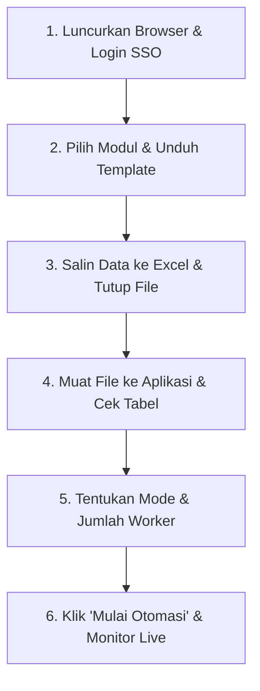
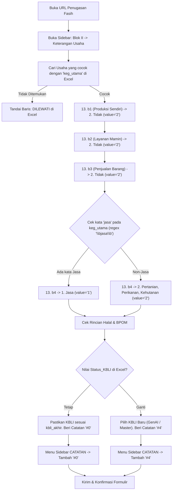
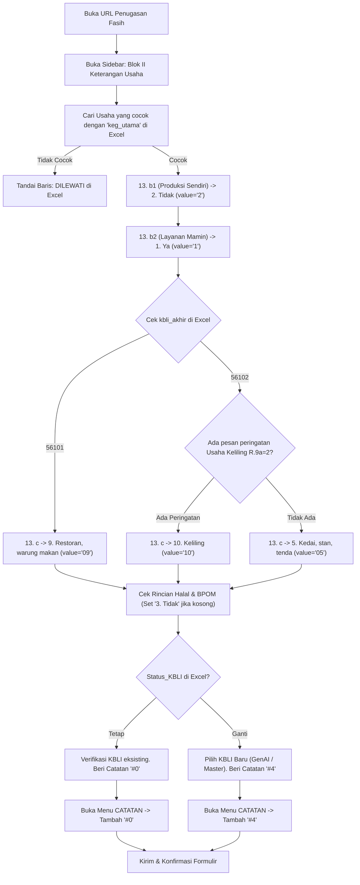
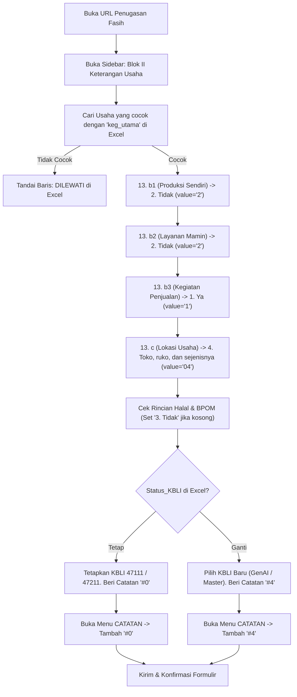
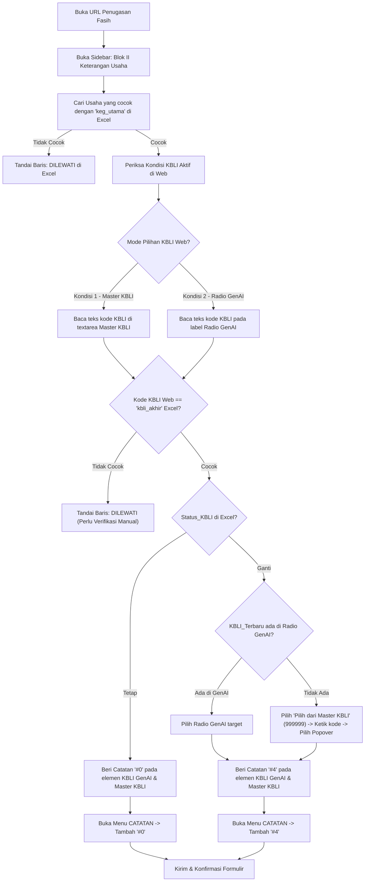
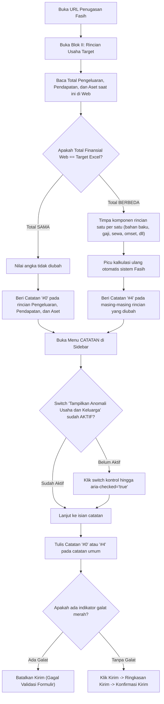
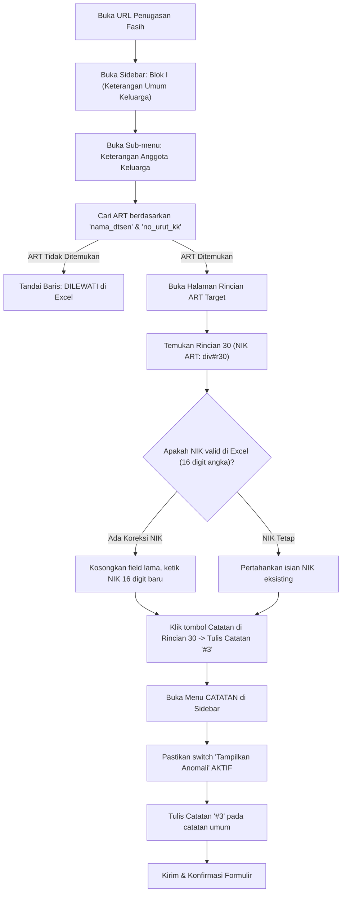
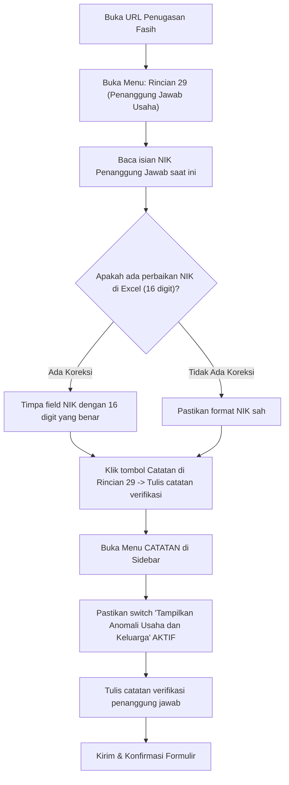
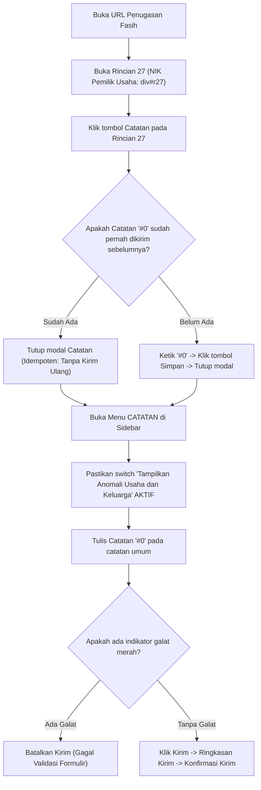
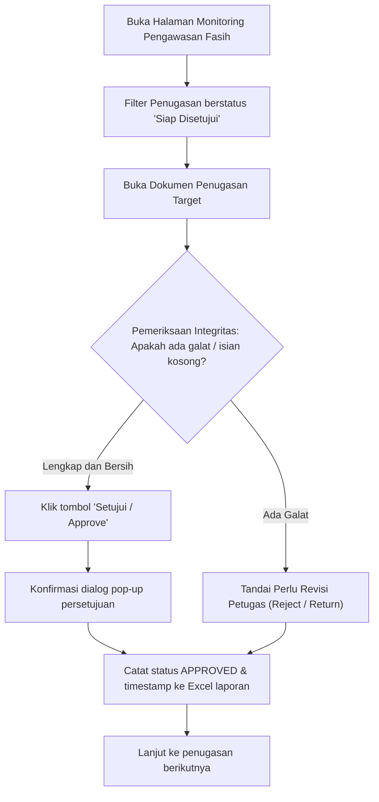

# 🚀 FASIH 3603 Helper
*Suite Otomasi Survei, Pembersihan Data (Data Cleaning), & Verifikasi KBLI*  
**Badan Pusat Statistik (BPS) Kabupaten Tangerang (Kode Wilayah: 3603)**

---

## 📌 Daftar Isi
1. [Tentang Aplikasi & Arsitektur](#-tentang-aplikasi--arsitektur)
2. [Panduan Cepat Pengguna Baru (Quick Start Workflow)](#-panduan-cepat-pengguna-baru-quick-start-workflow)
3. [Kamus Standar Kode Catatan / Remarks BPS](#-kamus-standar-kode-catatan--remarks-bps)
4. [Penjelasan Mendalam Algoritma & Logika per Modul (Lengkap dengan Flowchart)](#-penjelasan-mendalam-algoritma--logika-per-modul-lengkap-dengan-flowchart)
   - [4.1. 🌾 Modul KBLI Kategori A SE2026 (`kbli_kategori_A`)](#41--modul-kbli-kategori-a-se2026-kbli_kategori_a)
   - [4.2. 📦 Modul KBLI PMM SE2026 (Penyedia Makan Minum) (`kbli_pmm`)](#42--modul-kbli-pmm-se2026-penyedia-makan-minum-kbli_pmm)
   - [4.3. 🛒 Modul KBLI Sembako SE2026 (`kbli_sembako`)](#43--modul-kbli-sembako-se2026-kbli_sembako)
   - [4.4. 🏷️ Modul Remark KBLI SE2026 (Umum) (`remark_kbli`)](#44-️-modul-remark-kbli-se2026-umum-remark_kbli)
   - [4.5. 🧹 Modul Cleaning Usaha SE2026 (`cleaning_usaha`)](#45--modul-cleaning-usaha-se2026-cleaning_usaha)
   - [4.6. 🆔 Modul Cleaning NIK R30 SE2026 (Anggota Keluarga / ART) (`cleaning_nik_r30`)](#46--modul-cleaning-nik-r30-se2026-anggota-keluarga--art-cleaning_nik_r30)
   - [4.7. 🆔 Modul Cleaning NIK R29 SE2026 (Penanggung Jawab Usaha) (`cleaning_nik_r29`)](#47--modul-cleaning-nik-r29-se2026-penanggung-jawab-usaha-cleaning_nik_r29)
   - [4.8. 🆔 Modul Cleaning NIK R27 SE2026 (Pemilik Usaha) (`cleaning_nik_r27`)](#48--modul-cleaning-nik-r27-se2026-pemilik-usaha-cleaning_nik_r27)
   - [4.9. ✅ Modul Approve SE2026 (PML / Taskforce) (`approve_se2026`)](#49--modul-approve-se2026-pml--taskforce-approve_se2026)
5. [Fitur Keamanan, Anti-Detection, & Penanganan Sesi SSO](#-fitur-keamanan-anti-detection--penanganan-sesi-sso)
6. [Panduan Instalasi & Build Installer Windows](#-panduan-instalasi--build-installer-windows)

---

## 🏛️ Tentang Aplikasi & Arsitektur

**FASIH 3603 Helper** dirancang khusus untuk mempermudah, menstandarkan, dan mengotomasi penjaminan kualitas data survei dan sensus (seperti **Sensus Ekonomi SE2026**) pada portal **Fasih BPS** ([https://fasih-sm.bps.go.id](https://fasih-sm.bps.go.id)).

Aplikasi ini tersedia dalam **2 varian eksekusi**:

| Komponen | 🖥️ Desktop App (Python + Playwright) | 🌐 Browser Extension (Chrome/Edge MV3) |
| :--- | :--- | :--- |
| **Bentuk** | Aplikasi Windows mandiri (`.exe` installer) | Ekstensi browser di toolbar Google Chrome / MS Edge |
| **Pusat Kontrol** | Antarmuka grafis kaya fitur (CustomTkinter) | Panel samping (*Side Panel*) berdampingan dengan tab web |
| **Kapasitas** | Multi-Worker paralel (1 s.d. 5 worker konkuren) | Multi-Tab Worker (1 s.d. 3 tab browser konkuren) |
| **Instalasi Python** | **Tidak perlu** (cukup jalankan file setup installer) | **Tidak perlu** (cukup muat folder ekstensi) |
| **Tujuan Utama** | Pengolahan data massal ribuan baris otomatis | Operasional harian fleksibel semi-manual / inspeksi cepat |

---

## 🚦 Panduan Cepat Pengguna Baru (Quick Start Workflow)



1. **Langkah 1: Siapkan Browser & Sesi Login**:
   - Buka aplikasi **FASIH 3603 Helper**.
   - Klik tombol **🌐 Buka Browser** pada bilah atas aplikasi (atau buka Chrome normal).
   - Masuk ke portal [https://fasih-sm.bps.go.id](https://fasih-sm.bps.go.id) dan pastikan akun SSO BPS Anda telah login aktif.
2. **Langkah 2: Pilih Modul & Unduh Template**:
   - Pilih menu modul yang sesuai di sidebar kiri (misal: *KBLI Kategori A*).
   - Klik tombol **📥 Unduh Template** untuk mendapatkan format Excel resmi dengan header standar.
3. **Langkah 3: Salin Data & Tutup Excel**:
   - Isi baris data penugasan Anda ke dalam template tersebut.
   - **PENTING**: Simpan dan **tutup (*close*)** file Excel di komputer Anda sebelum memulai otomasi agar sistem operasi tidak mengunci file saat bot hendak menulis status hasil eksekusi.
4. **Langkah 4: Muat File Excel ke Aplikasi**:
   - Klik **📂 Pilih File**, pilih file Excel Anda.
   - Aplikasi akan otomatis memvalidasi struktur kolom dan menampilkan baris data pada tabel pratinjau (*Live Table*).
5. **Langkah 5: Tentukan Mode Eksekusi**:
   - **Mode Produksi**: Bot langsung mengisi formulir, mengonfirmasi modal, dan mengirimkan (*submit*) data secara otomatis tanpa interupsi.
   - **Mode Debug / Review Submit**: Bot mengisi formulir dan memunculkan pop-up konfirmasi kirim, lalu **berhenti menunggu tinjauan Anda**. Anda cukup menekan tombol **ENTER** pada keyboard jika data sudah sesuai untuk lanjut ke baris berikutnya.
6. **Langkah 6: Mulai Otomasi**:
   - Klik **▶️ Mulai Otomasi**. Pantau progres melalui kartu metrik, status baris tabel, dan tab **Log Terminal**. Anda dapat mengklik **⏸️ Jeda** atau **⏹️ Berhenti Aman** kapan saja.

---

## 🏷️ Kamus Standar Kode Catatan / Remarks BPS

Pada formulir Fasih SE2026, setiap field yang mengalami penyesuaian atau verifikasi wajib dibubuhi kode catatan (*remarks*) melalui tombol **Catatan** di samping rincian maupun di menu sidebar **CATATAN**:

| Kode Remark | Arti Standar BPS | Modul yang Menggunakan | Kapan Kode Ini Dipakai? |
| :---: | :--- | :--- | :--- |
| **`#0`** | **Data Tetap / Terkonfirmasi Valid** | `kbli_kategori_A`<br>`kbli_pmm`<br>`kbli_sembako`<br>`remark_kbli`<br>`cleaning_usaha`<br>`cleaning_nik_r27` | Ketika isian formulir lapangan diperiksa dan sudah sesuai (Status KBLI "Tetap", nilai finansial sama, atau identitas pemilik usaha valid tanpa koreksi). |
| **`#3`** | **Klarifikasi NIK Kependudukan** | `cleaning_nik_r30` | Khusus pada Rincian 30 NIK Anggota Rumah Tangga (ART) yang telah ditelusuri ke dokumen keluarga / kartu keluarga / dinas dukcapil. |
| **`#4`** | **Koreksi / Perubahan Data** | `kbli_kategori_A`<br>`kbli_pmm`<br>`kbli_sembako`<br>`remark_kbli`<br>`cleaning_usaha` | Ketika kode KBLI diganti dengan kode baru, atau ketika komponen pengeluaran/pendapatan usaha diperbaiki dari nilai aslinya. |

---

## 🧠 Penjelasan Mendalam Algoritma & Logika per Modul (Lengkap dengan Flowchart)

---

### 4.1. 🌾 Modul KBLI Kategori A SE2026 (`kbli_kategori_A`)

#### A. Latar Belakang & Tujuan
Menangani anomali unit usaha pada **Kategori A** (Pertanian, Kehutanan, dan Perikanan) serta unit **Jasa Pertanian/Perikanan**. Modul ini mengotomasi pengisian 4 rincian karakteristik usaha (13. b1 s.d. 13. b4), penanganan sertifikat halal & BPOM, serta penyesuaian KBLI.

#### B. Kolom Excel yang Dibutuhkan
* Wajib: `keg_utama`, `kbli_akhir`, `url`, `Status_KBLI`, `KBLI_Terbaru`
* Opsional: `Status_Eksekusi`, `Keterangan`

#### C. Diagram Alur Logika (Flowchart):


#### D. Detail Aturan Percabangan:
1. **Deteksi Kata Kunci Jasa (13. b4)**:
   - Bot memeriksa nilai `keg_utama` menggunakan pencarian kata *whole-word* `\bjasa\b` secara *case-insensitive*.
   - **Memilih `1. Jasa` (`value="1"`)** jika kegiatan utama berupa: *JASA PENGGILINGAN PADI*, *Jasa air taman atau menyiram tanaman*, *JASA PEMOTONGAN POHON DAN JUAL KAYU*, *JASA PENEBANGAN POHON*, *Jasa angkut hasil pertanian*, *Jasa tanam benih padi*, *Jasa penyewaan traktor*, *JASA PENYEDIAAN TEMPAT PEMANCINGAN IKAN*, dsb.
   - **Memilih `2. Pertanian, Perikanan, dan Kehutanan` (`value="2"`)** jika kegiatan utama non-jasa: *Pertanian Padi Sawah*, *Budidaya Ikan Lele*, *Perkebunan Kelapa Sawit*, *Peternakan Ayam*, dsb.
2. **Karakteristik 13. b1, 13. b2, 13. b3**:
   - Seluruhnya otomatis disetel ke **`2. Tidak`** (`value="2"`).
3. **Produk Halal & Izin Edar BPOM**:
   - Jika elemen rincian sertifikasi halal/BPOM muncul di halaman dan belum memiliki pilihan aktif, bot otomatis memilih opsi **`3. Tidak/Belum`** untuk menghindari galat validasi submit.
4. **KBLI & Catatan**:
   - **Tetap**: Memvalidasi kode lama, membubuhkan catatan `#0` pada elemen KBLI GenAI, Master KBLI, dan menu sidebar CATATAN.
   - **Ganti**: Memilih kode KBLI baru (jika tidak ada di opsi GenAI, bot otomatis memilih opsi *Pilih dari Master KBLI*, mengetikkan kode baru, dan memilih dari popover dropdown), lalu membubuhkan catatan `#4` di elemen KBLI dan sidebar CATATAN.

---

### 4.2. 📦 Modul KBLI PMM SE2026 (Penyedia Makan Minum) (`kbli_pmm`)

#### A. Latar Belakang & Tujuan
Menangani klasifikasi usaha **Penyediaan Makanan dan Minuman (PMM)** seperti restoran, rumah makan, warung makan, kafe, katering, kedai tenda, dan pedagang keliling. Memisahkan antara usaha restoran/tempat menetap (**56101**) dan kedai keliling/kaki lima (**56102**).

#### B. Kolom Excel yang Dibutuhkan
* Wajib: `keg_utama`, `kbli_akhir` (diisi 56101 atau 56102), `url`, `Status_KBLI`, `KBLI_Terbaru`
* Opsional: `Status_Eksekusi`, `Keterangan`

#### C. Diagram Alur Logika (Flowchart):


#### D. Detail Aturan Percabangan:
1. **Pengisian Karakteristik Usaha PMM**:
   - **13. b1** (Memproduksi barang di lokasi ini?): Pilih **`2. Tidak`** (`value="2"`).
   - **13. b2** (Menyediakan layanan makan dan minum?): Pilih **`1. Ya`** (`value="1"`).
   - Mengisi rincian **13. c (Aktivitas utama penyediaan mamin)** yang muncul dinamis berdasarkan `kbli_akhir`:
     - **Jika `kbli_akhir == "56101"`**: Memilih opsi **`9. Restoran, warung makan, dan sejenisnya`** (`value="09"`).
     - **Jika `kbli_akhir == "56102"`**: Memilih opsi **`5. Kedai, stan, tenda`** (`value="05"`).
     - **Aturan Pengecualian Usaha Keliling**: Jika terdeteksi peringatan/anomali *"Jika R.9a diisi kode 2 (Usaha Keliling), maka R.13c diisi kode 10"*, bot otomatis memilih opsi **`10. Keliling`** (`value="10"`).
2. **Pengecekan Sertifikasi Halal & BPOM**:
   - Jika rincian sertifikasi halal/BPOM tersedia dan belum terpilih, disetel ke **`3. Tidak/Belum`**.
3. **Verifikasi KBLI & Remarks**:
   - Jika `Status_KBLI == "Tetap"`: Memvalidasi kode eksisting dan menulis catatan `#0` pada GenAI, Master KBLI, dan sidebar CATATAN.
   - Jika `Status_KBLI == "Ganti"`: Memilih kode `KBLI_Terbaru` (via GenAI / Master KBLI) dan menulis catatan `#4`.

---

### 4.3. 🛒 Modul KBLI Sembako SE2026 (`kbli_sembako`)

#### A. Latar Belakang & Tujuan
Menangani anomali perdagangan eceran sembako dan bahan pokok. Mengoreksi dan memisahkan unit usaha minimarket/toko modern (**KBLI 47111**) dengan toko kelontong tradisional / warung sembako / toko beras (**KBLI 47211**).

#### B. Kolom Excel yang Dibutuhkan
* Wajib: `keg_utama`, `kbli_akhir`, `url`, `Status_KBLI`, `KBLI_Terbaru`
* Opsional: `Status_Eksekusi`, `Keterangan`

#### C. Diagram Alur Logika (Flowchart):


#### D. Detail Aturan Percabangan:
1. **Pengisian Karakteristik Usaha Sembako**:
   - **13. b1** (Memproduksi barang?): Pilih **`2. Tidak`** (`value="2"`).
   - **13. b2** (Layanan makan minum?): Pilih **`2. Tidak`** (`value="2"`).
   - **13. b3** (Melakukan kegiatan penjualan barang dagangan?): Pilih **`1. Ya`** (`value="1"`).
   - **13. c** (Lokasi usaha): Pilih **`4. Toko, ruko, dan sejenisnya`** (`value="04"`).
2. **Penyesuaian KBLI**:
   - Minimarket modern (Indomaret, Alfamart, dsb) -> diarahkan ke **47111**.
   - Toko sembako tradisional / warung beras -> diarahkan ke **47211**.
3. **Penyematan Catatan**: Menambahkan catatan `#0` jika KBLI tetap atau `#4` jika KBLI diganti pada elemen KBLI dan sidebar CATATAN.

---

### 4.4. 🏷️ Modul Remark KBLI SE2026 (Umum) (`remark_kbli`)

#### A. Latar Belakang & Tujuan
Modul generalis untuk memverifikasi dan mengubah kode KBLI di luar sektor khusus (seperti industri manufaktur, bengkel, toko pakaian, jasa transportasi, salon, properti, dll).

#### B. Kolom Excel yang Dibutuhkan
* Wajib: `keg_utama`, `kbli_akhir`, `url`, `Status_KBLI`, `KBLI_Terbaru`
* Opsional: `Status_Eksekusi`, `Keterangan`

#### C. Diagram Alur Logika (Flowchart):


#### D. Detail Aturan Percabangan:
1. **Pemeriksaan Kode KBLI Eksisting**:
   - Jika radio *Master KBLI* aktif: bot membaca textarea placeholder dan teks nilai KBLI.
   - Jika radio *GenAI* aktif: bot membaca teks label radio button.
   - Jika kode KBLI pada web tidak sama dengan `kbli_akhir` di Excel, bot tidak memaksakan perubahan, melainkan menandainya sebagai `DILEWATI` demi keamanan data.
2. **KBLI Tetap vs Ganti**:
   - Tetap: Mempertahankan kode dan memberi remark `#0`.
   - Ganti: Memilih kode baru dari radio GenAI; jika tidak ada, menggunakan pencarian Master KBLI (value `999999`), lalu memberi remark `#4`.

---

### 4.5. 🧹 Modul Cleaning Usaha SE2026 (`cleaning_usaha`)

#### A. Latar Belakang & Tujuan
Menangani anomali data finansial pada Blok II:
1. Rincian **Pengeluaran Usaha** (bahan baku, upah pekerja, sewa tempat, listrik/air, dll) beserta **Total Pengeluaran**.
2. Rincian **Pendapatan Usaha** (omset penjualan, jasa layanan, dll) beserta **Total Pendapatan**.
3. Rincian **Nilai Aset Modal** (aset bergerak, tidak bergerak, perlengkapan).

#### B. Kolom Excel yang Dibutuhkan
* Wajib: `url`, `Total_Pengeluaran`, `Total_Pendapatan`
* Komponen Rincian: `Pengeluaran_BahanBaku`, `Pengeluaran_Gaji`, `Pengeluaran_Sewa`, `Pengeluaran_Lainnya`, `Pendapatan_Penjualan`, `Pendapatan_Jasa`, `Nilai_Aset`
* Opsional: `Status_Eksekusi`, `Keterangan`

#### C. Diagram Alur Logika (Flowchart):


#### D. Detail Aturan Percabangan:
1. **Perbandingan Total**:
   - Jika nilai total pada web sudah sama persis dengan angka target Excel, bot tidak menyentuh field angka (mencegah *dirty state* form yang tidak perlu) dan langsung membubuhkan catatan `#0`.
   - Jika terdapat selisih, bot mengisi rincian komponen pengeluaran/pendapatan, memicu event `input` dan `change`, lalu membubuhkan catatan `#4`.
2. **Aktivasi Toggle Anomali**:
   - Membuka menu sidebar CATATAN, mengecek elemen `div#cek_anomali_button`.
   - Mengaktifkan toggle switch hingga `aria-checked="true"` agar data anomali dapat terkonfirmasi di server pusat.

---

### 4.6. 🆔 Modul Cleaning NIK R30 SE2026 (Anggota Keluarga / ART) (`cleaning_nik_r30`)

#### A. Latar Belakang & Tujuan
Menangani data anomali kependudukan keluarga pada **Blok I (Keterangan Anggota Keluarga)**, khususnya **Rincian 30 (R30 - NIK Anggota Rumah Tangga)** yang terisi NIK dummy (seperti 000000..., 999999...), kurang dari 16 digit, atau perlu penegasan verifikasi lapangan.

#### B. Kolom Excel yang Dibutuhkan
* `no_urut_kk` (Nomor urut anggota keluarga: 1, 2, 3...)
* `nama_dtsen` (Nama lengkap anggota keluarga)
* `nik_fasih` (NIK yang tertera di Fasih saat ini)
* `nik_matched` (NIK hasil pemadanan data dukcapil/lapangan)
* `url` (Link penugasan Fasih)

#### C. Diagram Alur Logika (Flowchart):


#### D. Detail Aturan Percabangan:
1. **Pencarian ART**: Bot memeriksa kesesuaian antara nama anggota keluarga (`nama_dtsen`) dan nomor urut di Kartu Keluarga (`no_urut_kk`) pada sub-sidebar.
2. **Koreksi NIK & Remark `#3`**:
   - Jika terdapat NIK baru dari hasil pemadanan dokumen (16 digit): bot mengosongkan input lama dan mengetikkan NIK yang baru.
   - Membuka modal Catatan pada Rincian 30 dan membubuhkan catatan **`#3`**.
   - Membuka sidebar CATATAN, memastikan switch anomali aktif, dan membubuhkan catatan `#3`.

---

### 4.7. 🆔 Modul Cleaning NIK R29 SE2026 (Penanggung Jawab Usaha) (`cleaning_nik_r29`)

#### A. Latar Belakang & Tujuan
Menangani verifikasi dan pembersihan identitas **Penanggung Jawab Usaha pada Rincian 29 (R29)**.

#### B. Kolom Excel yang Dibutuhkan
* `keg_utama` / `nama_usaha`, `nik_target`, `url`, `Status_Eksekusi`, `Keterangan`

#### C. Diagram Alur Logika (Flowchart):


#### D. Detail Aturan Percabangan:
1. Memeriksa keberadaan NIK pada formulir R29.
2. Jika ada pembaruan digit NIK, field diperbarui dengan simulasi ketikan manusia.
3. Menyematkan catatan verifikasi identitas pengelola usaha pada field R29 dan menu sidebar CATATAN.

---

### 4.8. 🆔 Modul Cleaning NIK R27 SE2026 (Pemilik Usaha) (`cleaning_nik_r27`)

#### A. Latar Belakang & Tujuan
Menangani konfirmasi NIK **Pemilik Usaha pada Rincian 27 (R27)**. Memastikan NIK pemilik usaha yang sudah benar dibubuhi catatan pengesahan `#0` agar status anomali di portal pusat bersih.

#### B. Kolom Excel yang Dibutuhkan
* `keg_utama` / `nama_usaha`, `url`, `Status_Eksekusi`, `Keterangan`

#### C. Diagram Alur Logika (Flowchart):


#### D. Detail Aturan Percabangan:
1. **Pemeriksaan Idempoten**: Bot membaca riwayat pesan di modal catatan R27. Jika catatan `#0` sudah pernah dikirim, bot tidak mengirim ulang untuk menghindari banjir riwayat catatan.
2. **Penyelesaian**: Mengaktifkan switch anomali di Blok Catatan, membubuhkan catatan `#0`, dan melakukan submit formulir.

---

### 4.9. ✅ Modul Approve SE2026 (PML / Taskforce) (`approve_se2026`)

#### A. Latar Belakang & Tujuan
Dirancang untuk mempercepat tugas pengawasan bagi **PML (Pengawas)** dan **Tim Taskforce** dalam menyetujui (*approve*) dokumen hasil pencacahan dan data cleaning yang sudah berstatus lengkap secara massal.

#### B. Diagram Alur Logika (Flowchart):


#### C. Detail Tahapan:
1. Membuka daftar antrean dokumen pengawas.
2. Melakukan *smoke check* kelayakan formulir.
3. Menjalankan aksi persetujuan (*Approve*) dan menyimpan log audit.

---

## 🛡️ Fitur Keamanan, Anti-Detection, & Penanganan Sesi SSO

Aplikasi ini dilengkapi arsitektur pertahanan berlapis untuk menjamin kelancaran otomasi ribuan record tanpa terhalang proteksi firewall web server BPS:

1. **Simulasi Interaksi Manusiawi (*Human-Like Typing & Jitter*)**:
   - Seluruh klik tombol, pemilihan radio, dan pengetikan teks dilengkapi penundaan acak mikro (*micro-jitter* antara 0.1s s.d. 0.4s).
   - Menghindari pola request instan yang biasa dideteksi oleh Web Application Firewall (WAF F5 BIG-IP).
2. **Session Guard & Pemulihan Sesi Real-Time**:
   - Bot terus memantau status login SSO BPS pada setiap pergantian baris dan setiap klik tombol.
   - Jika sesi SSO berakhir di tengah jalan: bot **tidak akan crash atau gagal**, melainkan otomatis **menjeda pekerjaan (pause)**, memunculkan jendela browser ke layar depan agar Anda dapat login kembali, lalu melanjutkan baris yang tertunda secara mulus!
3. **Penyimpanan Checkpoint & Auto-Resume**:
   - Status pengerjaan tiap baris (`SUKSES`, `DILEWATI`, atau `GAGAL`) langsung disimpan seketika ke file Excel kerja.
   - Jika aplikasi ditutup atau komputer mati mendadak, Anda cukup memuat kembali file Excel yang sama, dan bot otomatis melewati (*skip*) baris yang sudah bertanda `SUKSES`.
4. **Proteksi File Lock Windows (`WinError 32`)**:
   - Jika file Excel sedang dibuka di aplikasi Microsoft Excel saat bot hendak menyimpan data, bot otomatis membuat salinan cadangan berkala (`_autosave.xlsx`) agar data tidak hilang dan aplikasi tidak berhenti mendadak.

---

## 📦 Panduan Instalasi & Build Installer Windows

### 1. Menjalankan via File Installer (Untuk Pengguna Umum / Non-Teknis)
Anda **tidak memerlukan Python** di komputer Anda. Cukup unduh dan jalankan file installer resmi:
* 📥 [FASIH_3603_Helper_Setup_v1.8.0.exe](file:///d:/3603%20BPS%20Kab%20Tangerang/2026/Sensus%20Ekonomi/Anomali/Fasih%203603%20Helper/desktop_app/dist_installer/FASIH_3603_Helper_Setup_v1.8.0.exe)
* Ikuti petunjuk wizard instalasi. Shortcut aplikasi akan otomatis terpasang di Desktop dan Menu Start Windows.

### 2. Menjalankan di Lingkungan Pengembangan (Developer Mode)
```powershell
# 1. Pindah ke direktori desktop_app
cd "d:\3603 BPS Kab Tangerang\2026\Sensus Ekonomi\Anomali\Fasih 3603 Helper\desktop_app"

# 2. Aktifkan environment Python (Conda)
conda activate automation

# 3. Jalankan aplikasi GUI desktop
python main.py
```

### 3. Kompilasi Ulang File Setup Installer (Build PyInstaller & Inno Setup)
Jika Anda melakukan perubahan kode sumber dan ingin mengemas ulang aplikasi ke installer Windows:
```powershell
cd "d:\3603 BPS Kab Tangerang\2026\Sensus Ekonomi\Anomali\Fasih 3603 Helper\desktop_app"
python build/build_exe.py
```
*Skrip `build_exe.py` akan secara otomatis menjalankan PyInstaller (bundle onedir) dan memanggil Inno Setup Compiler 7 untuk membuat file `.exe` setup baru di dalam folder `dist_installer/`.*

---

## 📞 Bantuan & Dukungan Teknis
Aplikasi ini dikembangkan untuk mendukung kelancaran kegiatan sensus dan survei di **BPS Kabupaten Tangerang**.  
Jika Anda menemukan kendala teknis, anomali baru pada formulir Fasih, atau memerlukan penyesuaian aturan modul, silakan hubungi tim pengembang IT BPS Kabupaten Tangerang.
